# Build plan: Barista Training Tracker

MGIS 130 Build Project · Web-App Track · Hannah Curran

**Live app:** https://hlc9493.github.io/Build-Project-/

## The problem

At a busy coffee shop, a trainer has no quick way to see which skills a new
barista has been trained on, or how well they can actually do each one. Shifts
get spent re-teaching some skills while others are missed, and new hires can
end up on a station before they are ready.

- **Who hurts:** the trainer (me), the new hire, and the shift supervisor who
  has to decide where a new hire can safely work.
- **What it costs:** training time that is paid but wasted, and new hires put
  on a station before they are ready. 
- **How it works today:** we just use a course on a learning app that Starbucks created, very inefficient and doesn't track progress or knowledge at all
- **Why this solution:** one screen per trainee that shows how confident they
  are on each skill, which stations they are ready for, and what to work on
  next shift.

## Scope

**In:** a rating for each skill (Shown, Practicing, Confident), a training
score, station-ready badges, a team overview, dates and notes on each skill,
"how to teach it" instructions, and a "work on next shift" list. Saved on the
trainer's device, and fits both phone and computer screens.

**Out (on purpose):** logins, sharing between devices and real employee
records. Those need a server. The app runs on one device and uses first names
or made-up names only, so no personal data goes in the repo.

## Milestones

| # | Milestone | Planned | Finished | Done looks like |
|---|-----------|---------|----------|-----------------|
| 1 | One trainee's checklist works | Thu Nov 12 | Nov 13 | Skills load from `skills.json`, ticking one moves the progress bar, live on GitHub Pages |
| 2 | Several trainees, and it saves | Sun Nov 15 | Nov 13 | Add a trainee, switch between them, a refresh keeps every tick |
| 3 | "Next shift" view, phone ready | Tue Nov 17 | Nov 13 | Shows the next 3 skills to cover; no sideways scrolling at phone width |
| 3b | Added features | Not in original plan | Nov 19 | Team overview, station badges, dates and notes, coffee theme, layout for computer screens |
| 3c | Professor feedback changes | Not in original plan | Ratings instead of checkboxes, "how to teach it" instructions, one clear first step for a new user |
| 4 | Improvement measured, documents written | Thu Nov 19, moved to Tue Nov 24 | Before and after timing recorded; README and reflection finished |
| – | Submit on myCourses | Fri Nov 20, moved to Tue Nov 24 | [Hannah: date] | Link, plan, status updates and reflection uploaded |

The due date moved from Nov 20 to Nov 24 when my professor extended it.

## First three tasks

| Task | By | Done looks like |
|------|----|-----------------|
| Commit this plan to the Build repo | Wed Nov 11 | `PLAN.md` is in the repo |
| Commit the first screen and turn on GitHub Pages | Thu Nov 12 | The live link shows the checklist |
| Replace the sample skills with my real training list | Thu Nov 12 | `skills.json` matches how I train, in my own words |

## Critical path

Skills load from the data file → ratings save and survive a refresh → the
"work on next shift" view. Each step depends on the one before it. Styling,
badges, the team overview and the computer layout had slack: they were added
after the core worked, so they could slip without making the Build late.

## Retroactive project review (written Nov 24)

The plan above was written at the start. This section looks back at how the
work actually happened: every task, the order they depended on each other, and
the moments where a key piece of the app clicked into place.

### Tasks

| ID | Task | Depends on | Done | 
|----|------|------------|------|-----------|
| T1 | Pick the problem and scope it small | – | Nov 11 
| T2 | Write the project plan (`PLAN.md`) | T1 | Nov 11 
| T3 | Create the repo and turn on GitHub Pages | T1 | Nov 11  
| T4 | Build the page structure (`index.html`, `style.css`) | T3 | Nov 11 
| T5 | Write the skills list (`skills.json`) | T1 | Nov 11 
| T6 | Load the skills and draw the checklist (`app.js`) | T4, T5 | Nov 11 
| T7 | Fix the white screen and get the live link working | T6 | Nov 13 
| T8 | Several trainees, saved in the browser | T7 | Nov 13 
| T9 | "Next shift" list and removing a trainee | T8 | Nov 13 
| T10 | Team overview, station badges, dates and notes | T8 | Nov 19 
| T11 | Two-column layout for computer screens | T4 | Nov 19 
| T12 | Email my professor for feedback | T9 | Nov 19 | (email, no commit) 
| T13 | Feedback changes: clear first step, ratings, how-to instructions | T12 
| T14 | Pixel sprites and coffeehouse theme | T11 | Nov 24  
| T15 | Time the old method against the app | T13  
| T16 | Finish README, plan and reflection | T13, T15 | Nov 24 
| T17 | Submit on myCourses | T16 | Nov 24 
| T18 | Practice the live demo | T17 

### Critical path diagram

Orange tasks are the critical path: each one had to finish before the next
could start, so any delay there would have delayed the whole project. Cream
tasks had slack and could happen alongside. Green hexagons are milestones.

```mermaid
flowchart LR
  T1["T1 Pick problem"] --> T3["T3 Repo + Pages"]
  T1 --> T2["T2 Write plan"]
  T1 --> T5["T5 Skills list"]
  T3 --> T4["T4 Page structure"]
  T4 --> T6["T6 Draw checklist"]
  T5 --> T6
  T6 --> T7["T7 Fix white screen"]
  T7 --> M1{{"M1 Checklist live"}}
  M1 --> T8["T8 Trainees + saving"]
  T8 --> M2{{"M2 Progress saves"}}
  M2 --> T9["T9 Next shift view"]
  T9 --> M3{{"M3 Core app complete"}}
  M2 --> T10["T10 Team, badges, notes"]
  T4 --> T11["T11 Computer layout"]
  T10 --> M4{{"M4 Supervisor features"}}
  T11 --> M4
  M3 --> T12["T12 Ask for feedback"]
  T12 --> T13["T13 Ratings + how-to"]
  T13 --> M5{{"M5 Tracks quality"}}
  T11 --> T14["T14 Sprites + theme"]
  T14 --> M6{{"M6 Own look"}}
  M5 --> T15["T15 Time before/after"]
  T15 --> T16["T16 README + reflection"]
  T16 --> T17["T17 Submit"]
  M6 --> T17
  T17 --> M7{{"M7 Submitted"}}

  classDef critical fill:#c47a2c,stroke:#5c3a24,color:#ffffff
  classDef slack fill:#fbf4e6,stroke:#7a4b2a,color:#2e1d12
  classDef milestone fill:#6f8a32,stroke:#3f5f2a,color:#ffffff
  class T1,T3,T4,T6,T7,T8,T9,T12,T13,T15,T16,T17 critical
  class T2,T5,T10,T11,T14 slack
  class M1,M2,M3,M4,M5,M6,M7 milestone
```

**Critical path:** T1 → T3 → T4 → T6 → T7 → T8 → T9 → T12 → T13 → T15 → T16 → T17

**Slack:** writing the plan (T2) and the skills list (T5) could happen while the
page was being built. The supervisor features (T10), computer layout (T11) and
theme (T14) were extras built on top of a working app, so they could have been
cut without stopping the project. When time is short, those are the scope to
cut first.

### Milestones: when each piece clicked into place

| # | Milestone | Date | What clicked |
|---|-----------|------|--------------|
| M1 | Checklist live | Nov 13 | After a white screen, the skills loaded from `skills.json` on the live GitHub Pages link for the first time |
| M2 | Progress saves | Nov 13 | Several trainees could be added, and a refresh kept every tick |
| M3 | Core app complete | Nov 13 | The "next shift" list worked, after re-running a failed deployment. This answers the original problem |
| M4 | Supervisor features | Nov 19 | Team overview and station badges let a supervisor see who is ready, on phone or computer |
| M5 | Tracks quality | Nov 20 | Professor feedback turned checkboxes into Shown, Practicing and Confident ratings |
| M6 | Own look | Nov 24 | Pixel sprites and the coffeehouse theme |
| M7 | Submitted | Nov 24 | Link, plan, status updates and reflection on myCourses |

## Status updates

### Status update 1 (Nov 11, original plan)

- **Done:** Picked the problem: trainers have no quick way to track which
  skills each new barista has covered. Chose the Web-App Track and wrote this
  plan with four milestones and a critical path.
- **Next:** Milestone 1 by Thu Nov 12: one trainee's checklist that loads
  skills from `skills.json`, live on GitHub Pages. Then several trainees with
  saving (Nov 15), the "cover next shift" view (Nov 17), and measuring the
  improvement (Nov 19).
- **Blocked:** Nothing yet. Scope kept small on purpose: one device, no
  logins and no server, so it stays on GitHub Pages' free tier.

### Status update 2 (week 12, Nov 13)

- **Done:** Milestones 1 to 3. The checklist loads from `skills.json`,
  several trainees can be added, switched and removed, ticks survive a
  refresh, and the "cover next shift" view works. Live on GitHub Pages.
- **Next:** Measure the improvement, write the README and reflection.
- **Blocked:** Nothing. One GitHub Pages deployment failed on Nov 13; re-running
  it from the Actions tab fixed it. Known limit: progress saves on one device
  only, because sharing would need a server.

### Status update 3 (Nov 20, after professor feedback)

- **Done:** Added a team overview, station-ready badges, dates and notes, a
  coffee-shop theme and a two-column layout for computer screens (Nov 19).
  Asked my professor for feedback by email.
- **Feedback received:** hide the trainee dropdown when there are no
  trainees, so a new user has one clear path; use ratings instead of
  checkboxes to track quality, not just completion; optionally add
  instructions for each task.
- **Next:** Make all three changes, then finish the measurement, README and
  reflection by the new due date, Tue Nov 24.
- **Blocked:** Nothing.

## Measuring the improvement

Question; "What has this trainee not been trained on yet, and what
should they work on next?" 

| Method 
| Before: Starbucks courses
| After: this app 
